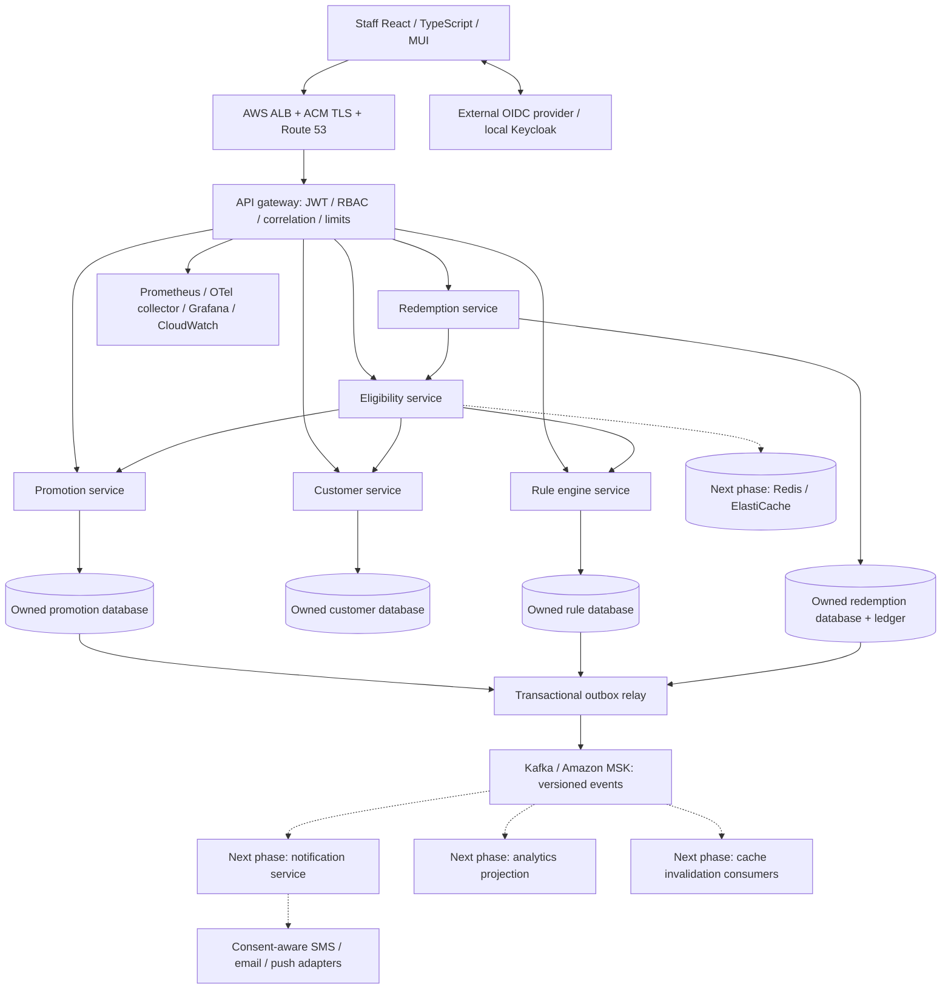
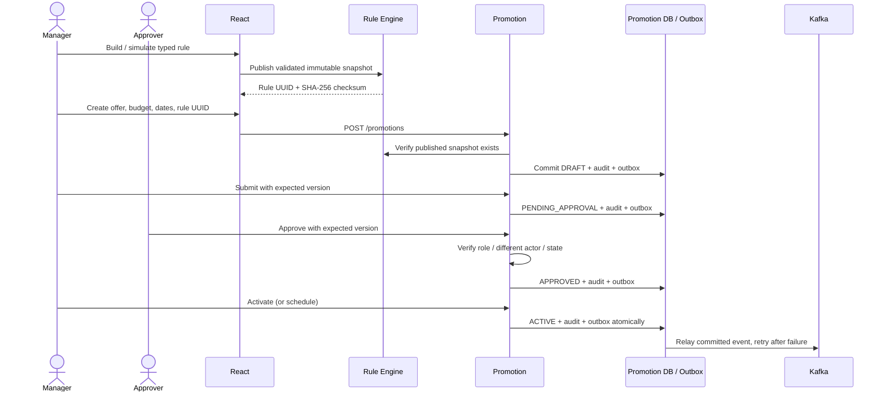
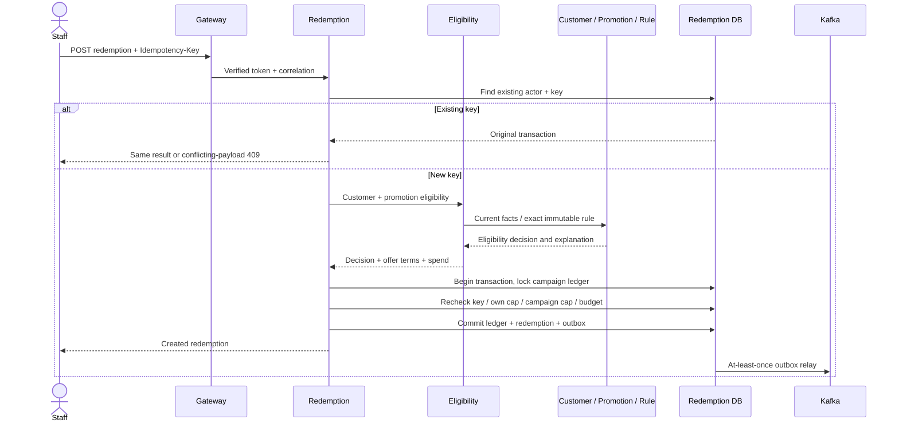

# Architecture and design decisions

## Target topology

Solid paths represent implemented synchronous operations. The Kafka relay exists; downstream notification/reporting projections and Redis integration are the next phase. Cloud components are a deployment design, not deployed resources.

Every business service owns its database. The local Compose database host has isolated databases for practicality; AWS RDS can share a managed cluster with separately scoped service credentials. Foreign keys never cross a service boundary. Kafka provides at-least-once delivery: a publish acknowledgment followed by a crash before marking the row can create a duplicate. Event consumers must commit a deduplication marker with their projection update. There are no implemented consumers yet, and no exactly-once claim.

## Promotion workflow

## Redemption workflow

## Major trade-offs

- **Typed rule AST rather than Drools:** the required boolean/comparison rules do not need agenda inference. This model is small, predictable, explainable and cannot execute user code. Drools becomes relevant if complex temporal rules or expert-maintained inference justify its operational complexity. Deterministic predicate order follows JSON child order; this slice applies each promotion independently and does not implement cross-offer priority/stacking conflict resolution.
- **PostgreSQL transaction/unique constraint/row lock:** guarantees budget/cap correctness within redemption ownership; Redis is not an authority. Creating a first ledger row can race, so the controller retries the whole rolled-back transaction up to three times after a uniqueness violation. Cancellation takes the same lock and refreshes the cached record before changing counters.
- **No distributed transaction:** eligibility is fetched before the redemption DB transaction. Campaign pause/customer change may race with redemption; this slice defines validity at eligibility read plus expiry recheck at commit. A strict “nothing commits after pause” policy requires authoritative reservations or revision fencing coordinated with promotion lifecycle. Do not claim that strict invariant here.
- **Outbox over dual-write:** committing business data and event record together prevents lost events from the DB/Kafka gap. The relay is simple; multiple replicas can publish duplicates. Production requires monitored retries, bounded backoff, poison-event handling and idempotent consumers.
- **No eligibility cache yet:** avoids introducing stale consent/usage decisions before event consumers exist. Future cache keys must include customer attribute version, rule checksum, campaign version and effective date; TTL must not exceed the next boundary, and transactional usage checks always occur at redemption.
- **REST for decisions, Kafka for projections:** lets a user receive an immediate explainable outcome while reporting/delivery stay off the transactional path. HTTP client has bounded connect/read timeouts and does not retry writes. Circuit breakers, bulkheads and provider retries remain a release gate.
- **Monorepo with separate executables:** one pinned BOM and reusable technical concerns reduce initial drift while every service remains an independent deployable JAR/image. No domain entity classes are shared across services. The first slice uses internal JSON maps for composition; harden these to generated versioned DTOs and contract tests next.
- **Security is enforced server-side:** production JWT issuer, signature, timestamps, audience and roles are checked by each service. Local profile identities are deliberately synthetic. Gateway limiting is per-process; WAF/distributed Redis limiting is needed for multi-replica enforcement.
